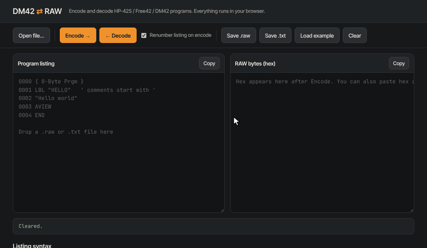

# DM42EncoderDecoder

A single-file, in-browser encoder/decoder for SwissMicros DM42 / Free42 / HP-42S programs.
Open `DM42EncoderDecoder.html` in any browser. It runs entirely offline, with no server.



The demo types a short program and encodes it, opens `DPLOT.raw`, pastes hex and decodes it, then saves a `.raw` file.

- **Left:** program listing with line numbers, starting `0000 { n-Byte Prgm }`.
- **Right:** the raw bytes as hex, one line per instruction.
- **Encode →** turns the listing into raw bytes and renumbers it. **← Decode** turns hex back into a listing.
- **Open file / drag and drop:** `.raw` files are decoded; text listings (`.txt`) are encoded.
- **Save .raw / Save .txt:** download the program for the calculator or as text.
- **Hide comments / Hide line numbers** (on each pane): display-only filters. Encoding always uses the full text, and a pane is read-only while something is hidden. Copy and Save .txt take what is shown, so they also export a clean listing.

## Listing syntax

| | Example |
|---|---|
| Comments start with `'`, `;` or `@` outside a string | `STO 01   ' keep it`, `RTN ; done`, `X<>Y @ swap` |
| Line numbers and the header are optional | `0001`, `01▸`, `01▶`, `01◆` |
| Strings and append | `"TEXT"`, `├"MORE"` or `\|-"MORE"`; line feed `[LF]`, escape `[ESC]` |
| Registers, stack, indirect, names | `STO 07`, `RCL ST X`, `STO IND 03`, `RCL "NAME"`, `XEQ IND "P"` |
| Numbers | `1.5ᴇ-3` or `1.5E-3`, `ᴇ3`, `-ᴇ`, comma decimals `14,1041` |
| Labels | `LBL "MAIN"`, `LBL 05`, `LBL A`, `LBL a` |
| Menus and keys | `KEY 1 XEQ 01`, `KEY -6 GTO 99` (shifted), `ASSIGN "X" TO 03`, `ASSIGN "X" TO -18` |
| Synthetic registers | `RCL 122`, `LBL ST L` (100–127, as imported from HP-41 code) |
| ASCII spellings | `/ * ^ -> <= >= != RDN CHS SIGMA+ x2` |
| Unknown bytes | decode as `XROM mm,ff` or `HEX F2 …` and encode back unchanged |

It covers the full HP-42S instruction set plus the Free42/DM42 extensions (`FUNC`, `LSTO`, `L4STK`, `X=?`, `XSTR`, …).
Plus42's named instructions (directories, units, TVM, plotting, `EQNSLV`, `GTOL`, …) are supported too, with byte codes taken from Free42's `stress.raw`.

### Plus42 mode

Tick **Plus42 mode** for Plus42 listings. It changes three things:

- `↑` in strings is byte `1E` (in DM42/Free42 listings `↑` and `^` are both byte `5E`).
- `'A*B+C*D'`, `` `A*B+C*D` ``, `EVAL 'A*B+C*D'` are equation literals, and `40076_km` is a unit value.
- Comments work as in DM42 mode (`'`, `;`, `@`). A `'` is only an equation when it is the whole instruction:
  at the start of the line, not followed by a space, and closed on the same line (`'A*B'`, `EVAL 'A*B'`).

Plus42 mode is off by default and not remembered between visits. Decoding a `.raw` with Plus42 equations,
units or the Plus42 `↑` turns it on for that session.
With it, Free42's `stress` test program (every instruction, 2645 bytes) and the Plus42 programs HPFX, HPOLY and MES encode byte-identical.
Byte codes follow Free42's `core_tables.cc` and `export_hp42s`. Numbers are terminated with `00` and END is written as `C0 00 0D`, the same as Free42.

## Tests

```
node tests/run.js
```

The tests load the codec straight from `DM42EncoderDecoder.html` and check:

- **Byte-exact output** against the DPLOT example and its reference hex dump from Thomas Okken's
  [txt2raw page](https://thomasokken.com/free42/unsupported/txt2raw/): 491 bytes, `{ 488-Byte Prgm }`.
- **Published `{ n-Byte Prgm }` sizes** of 12 real programs from Eddie Shore's blog and the HP Museum forum,
  plus an encode → decode → encode round trip for each.
- **Single instructions**, including Free42 extensions, indirect and stack arguments, local labels, comments and error reporting.
- **Regression cases from Thomas Okken's [program library](https://thomasokken.com/free42/42progs/)**: all 84 `.raw`/`.txt` pairs there
  (144 programs, 179 KB) were checked; see the report in the pull request that added these tests.

The Free42-only extensions are checked against Free42's source tables and by round trip. No published `.raw` file containing them was available to compare against.
